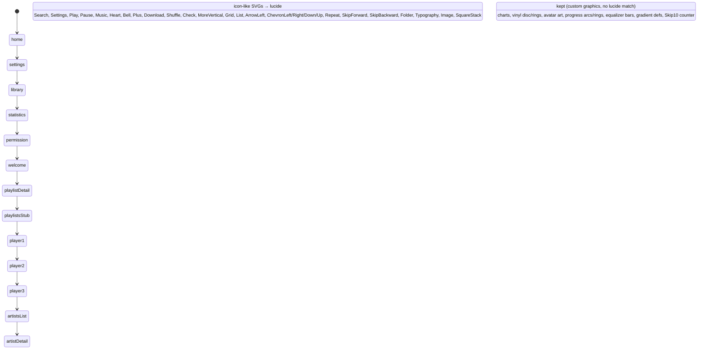

# Muzify — Project Progress & Files (Mermaid)

## 1. File map

```mermaid
graph TD
  ROOT["Muzify-App"]
  ROOT --> APP["App.js"]
  ROOT --> CFG["app.json / index.js / babel.config.js / metro.config.js / tailwind.config.js / global.css"]

  APP --> ROUTE["src/app/"]
  ROUTE --> HOME["home.jsx"]
  ROUTE --> SETTINGS["settings.jsx"]
  ROUTE --> LIBRARY["library.jsx"]
  ROUTE --> STATS["statistics.jsx"]
  ROUTE --> TABLAYOUT["(tabs)/_layout.jsx"]
  ROUTE --> PUB["(public)/_layout.jsx + index.jsx"]

  ROOT --> SCREENS["src/screens/"]
  SCREENS --> WELCOME["WelcomeScreen.jsx"]
  SCREENS --> PERMISSION["PermissionScreen.jsx"]

  ROOT --> PLAYLISTS["src/playlists/"]
  PLAYLISTS --> PLIST["playlists.jsx  (stub)"]
  PLAYLISTS --> PDETAIL["[playlistId].jsx"]

  ROOT --> PLAYERS["src/players/"]
  PLAYERS --> P1["PlayerScreen1/[id].jsx"]
  PLAYERS --> P2["PlayerScreen2/[id].jsx"]
  PLAYERS --> P3["PlayerScreen3/[id].jsx"]

  ROOT --> ARTISTS["src/artists/"]
  ARTISTS --> ALIST["artists.jsx"]
  ARTISTS --> ADETAIL["[artistsId].jsx"]

  ROOT --> COMP["src/components/"]
  ROOT --> CTX["src/context/"]
  ROOT --> CONSTANTS["src/constants/"]
  ROOT --> ASSETS["assets/*.png"]

  ROOT --> SVC["src/services/"]
  SVC --> AMETA["audioMetadata.js"]
  SVC --> FOLDER["musicFolder.js"]
  SVC --> SCANNER["musicScanner.js"]
  SVC --> IMPORTER["musicImporter.js"]
  SVC --> TAGW["tagWriter.js"]
  SVC --> ARTWORK["artworkCache.js"]

  ROOT --> AUDIO["src/audio/"]
  AUDIO --> ENGINE["audioEngine.js"]
  AUDIO --> PLAYER["player-context.jsx (real audio)"]
```

## 2. SVG → lucide-react-native conversion progress

## 3. Status

| File | SVG icons replaced | Custom graphics kept |
|------|-------------------|----------------------|
| `home.jsx` | Search, Settings, Play, Pause, Music | — |
| `settings.jsx` | ChevronLeft, ArrowLeft, Folder, Music, Check, Typography, Image, SquareStack, Play | — |
| `library.jsx` | Search, Grid, List, Play, Pause, Shuffle, Check, MoreVertical, ArrowLeft | AvatarArt, play-ring |
| `statistics.jsx` | — | AreaChart, ListeningClock, DonutChart, PieChart, DiscoveriesChart |
| `PermissionScreen.jsx` | Bell, Check, Folder, Music | — |
| `WelcomeScreen.jsx` | Music, ArrowLeft | — |
| `playlists/[playlistId].jsx` | ArrowLeft, Heart, Download, Shuffle, Play, Pause, Music | — |
| `players/PlayerScreen1/[id].jsx` | ArrowLeft, Heart, Shuffle, Repeat, Play, Pause, SkipForward, SkipBackward | Vinyl disc, rings, label |
| `players/PlayerScreen2/[id].jsx` | ArrowLeft, Shuffle, Repeat, Play, Pause, SkipForward, SkipBackward | Turntable stage, arc progress |
| `players/PlayerScreen3/[id].jsx` | ArrowLeft, Plus, Check, Play, Pause, SkipForward, Heart, Repeat, Shuffle, Music, Bell, Dots | PersonArt/WaveArt/RingsArt/SunsetArt, progress arc, Skip10 |
| `artists/artists.jsx` | ArrowLeft, Search, Play | — |
| `artists/[artistsId].jsx` | ArrowLeft, Check, Plus, Play, Pause, SkipForward | PersonArt/WaveArt/RingsArt/SunsetArt, progress ring |

## 4. Audio Engine Status

| Component | Status |
|-----------|--------|
| `expo-audio` dependency | Installed (v57.0.5) — replaced deprecated `expo-av` |
| `src/audio/audioEngine.js` | Created — real playback via `expo-audio` |
| `src/context/player-context.jsx` | Rewired to use the engine (no simulated timer) |
| Real audio playback | Implemented (play/pause/resume/seek/next/prev) |
| Repeat / shuffle | Implemented |
| Error handling | Implemented |
| Background playback | Configured via `setAudioModeAsync` (needs dev build + manifest) |
| Lock-screen controls | Not yet implemented |